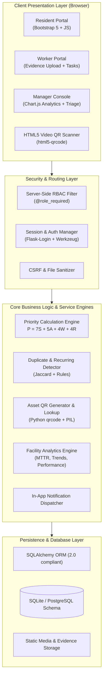
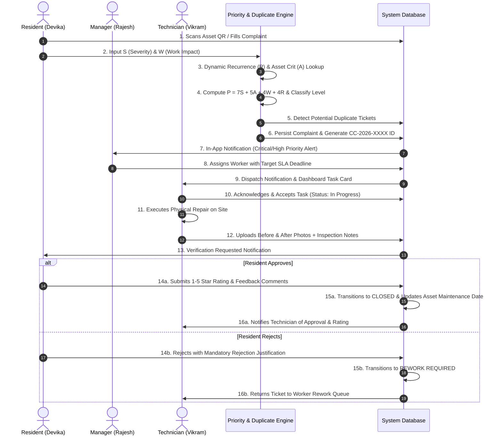
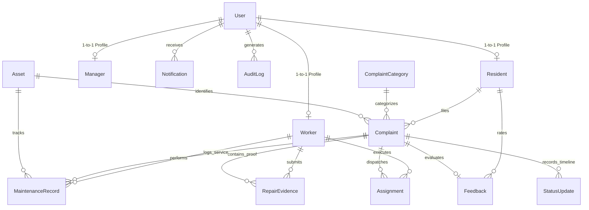

# Community Connect &mdash; System Architecture & Technical Specifications

## 1. System Architecture Overview

Community Connect is architected as a modular, three-tier enterprise web application adhering to the Model-View-Controller (MVC) and Service-Oriented pattern.

---

## 2. Complete 16-Step Maintenance Workflow

The core innovation of Community Connect is its closed-loop maintenance lifecycle, preventing premature ticket closures and ensuring technician accountability.

---

## 3. Relational Database Schema (ERD)

The database schema enforces referential integrity through foreign keys, indices, and cascade rules across 14 tables:

---

## 4. Intelligent Priority Algorithm Specification

### Formula:
$$P = 7S + 5A + 4W + 4R$$

### Theoretical Domain & Range:
- Variable Scales: $S, A, W, R \in [1, 5]$
- Minimum Theoretical Score: $7(1) + 5(1) + 4(1) + 4(1) = 20$
- Maximum Theoretical Score: $7(5) + 5(5) + 4(5) + 4(5) = 100$

### Variable Operational Definitions:
1. **$S$ (Severity)**:
   - Level 1: Minor cosmetic or low inconvenience (e.g. scuff on paint).
   - Level 2: Low functional impact (e.g. flickering garden light).
   - Level 3: Moderate malfunction affecting daily routines (e.g. intercom buzzing).
   - Level 4: Major disruption / safety hazard (e.g. lift door jamming, water pressure failure).
   - Level 5: Life safety emergency, structural defect, or total utility blackout (e.g. lift stuck with occupants, main water pipe rupture, fire sensor fault).
2. **$A$ (Asset Criticality)**:
   - Evaluated from the asset registry. Elevators = 5, Fire Pumps = 5, Hydro Booster Pumps = 5, Generators = 4, Drainage Sump = 3, CCTV = 3, Streetlights = 2, Garden Amenities = 1.
3. **$W$ (Work Impact)**:
   - Level 1: Single apartment isolated.
   - Level 2: Multiple flats on a corridor.
   - Level 3: Entire floor or wing.
   - Level 4: Entire building / block.
   - Level 5: Entire gated community.
4. **$R$ (Recurrence Score)**:
   - Dynamically calculated by scanning database history on the same asset or location within a 60-day window:
     - 0 prior incidents: $R = 1$ (Isolated event)
     - 1 prior incident: $R = 2$ (Repeat incident)
     - 2 prior incidents: $R = 3$ (Frequent fault)
     - 3 to 4 prior incidents: $R = 4$ (Chronic failure)
     - 5+ prior incidents: $R = 5$ (Systemic reliability hazard)

### Priority Category Thresholds:
- **Critical**: $P \ge 75$ (SLA: Attend within 2 hours)
- **High**: $55 \le P < 75$ (SLA: Attend within 24 hours)
- **Medium**: $35 \le P < 55$ (SLA: Attend within 48 hours)
- **Low**: $P < 35$ (SLA: Attend within 5 business days)

### Managerial Override Governance:
When conditions dictate adjustments, managers can manually override the priority tier. The system requires a mandatory documented justification and logs an immutable record into the `AuditLog` table.

---

## 5. Duplicate & Recurring Failure Detection Engine

1. **Deterministic Rule Filtering**:
   - Exact asset matching: If a newly submitted complaint matches an active asset under review, flag with `High Confidence`.
   - Category & Location matching: Same complaint category within the same building block within 14 days flagged with `Medium Confidence`.
2. **Textual N-Gram / Token Set Similarity**:
   - Calculates Jaccard token overlap between complaint titles and descriptions:
     $$J(A, B) = \frac{|A \cap B|}{|A \cup B|}$$
   - Any score exceeding 0.45 triggers a duplicate candidate suggestion.
3. **Reliability Warning Generator**:
   - Assets registering $\ge 3$ complaints within a 30-day window trigger a **Chronic Failure Alert** on the manager dashboard with root-cause overhaul advisories.
