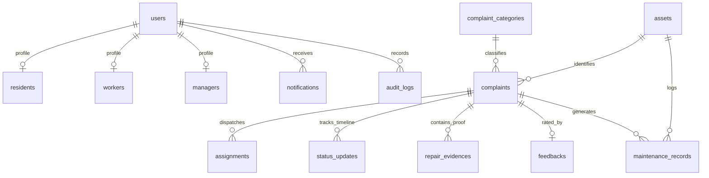

# Community Connect &mdash; Relational Database Schema & Data Dictionary

This document specifies the relational database schema implemented in Community Connect using SQLAlchemy ORM. The architecture is fully compatible with both SQLite and PostgreSQL.

---

## 1. Entity-Relationship Overview

---

## 2. Table Specifications

### A. Core Authentication & Identity

#### 1. `users`
Stores system accounts across all three user roles.
| Column | Type | Constraints | Description |
| :--- | :--- | :--- | :--- |
| `id` | INTEGER | PRIMARY KEY, AUTOINCREMENT | Unique user account ID |
| `username` | VARCHAR(64) | UNIQUE, NOT NULL, INDEX | Login identifier |
| `email` | VARCHAR(120) | UNIQUE, NOT NULL, INDEX | Contact email address |
| `password_hash` | VARCHAR(256) | NOT NULL | Werkzeug secure password hash |
| `role` | VARCHAR(20) | NOT NULL | `'resident'`, `'worker'`, or `'manager'` |
| `full_name` | VARCHAR(120) | NOT NULL | Display name |
| `phone` | VARCHAR(20) | NULLABLE | Primary contact telephone |
| `is_active` | BOOLEAN | DEFAULT 1, NOT NULL | Account active flag |
| `created_at` | DATETIME | DEFAULT CURRENT_TIMESTAMP | Account creation timestamp |
| `updated_at` | DATETIME | ON UPDATE CURRENT_TIMESTAMP | Last update timestamp |

#### 2. `residents`
Extended resident profile storing physical location details.
| Column | Type | Constraints | Description |
| :--- | :--- | :--- | :--- |
| `id` | INTEGER | PRIMARY KEY, AUTOINCREMENT | Resident profile ID |
| `user_id` | INTEGER | UNIQUE, NOT NULL, FK(`users.id` CASCADE) | Associated user account |
| `flat_no` | VARCHAR(20) | NOT NULL | Apartment / Flat number |
| `building_block`| VARCHAR(50) | NOT NULL | Tower or block identifier |
| `alternate_contact` | VARCHAR(20) | NULLABLE | Secondary telephone |
| `verified` | BOOLEAN | DEFAULT 1, NOT NULL | Resident identity verified flag |
| `created_at` | DATETIME | DEFAULT CURRENT_TIMESTAMP | Record creation timestamp |

#### 3. `workers`
Extended maintenance personnel profile with trade specializations.
| Column | Type | Constraints | Description |
| :--- | :--- | :--- | :--- |
| `id` | INTEGER | PRIMARY KEY, AUTOINCREMENT | Worker profile ID |
| `user_id` | INTEGER | UNIQUE, NOT NULL, FK(`users.id` CASCADE) | Associated user account |
| `specialty` | VARCHAR(80) | NOT NULL | Primary trade (Plumbing, Electrical, etc.) |
| `is_available` | BOOLEAN | DEFAULT 1, NOT NULL | Availability status for dispatch |
| `emergency_contact` | VARCHAR(20) | NULLABLE | On-call contact telephone |
| `created_at` | DATETIME | DEFAULT CURRENT_TIMESTAMP | Registration timestamp |

#### 4. `managers`
Community facility manager profile.
| Column | Type | Constraints | Description |
| :--- | :--- | :--- | :--- |
| `id` | INTEGER | PRIMARY KEY, AUTOINCREMENT | Manager profile ID |
| `user_id` | INTEGER | UNIQUE, NOT NULL, FK(`users.id` CASCADE) | Associated user account |
| `designation` | VARCHAR(80) | NOT NULL | Official title (e.g. Operations Manager) |
| `department` | VARCHAR(80) | NOT NULL | Department designation |
| `created_at` | DATETIME | DEFAULT CURRENT_TIMESTAMP | Creation timestamp |

---

### B. Asset Management

#### 5. `assets`
Physical infrastructure registry.
| Column | Type | Constraints | Description |
| :--- | :--- | :--- | :--- |
| `id` | INTEGER | PRIMARY KEY, AUTOINCREMENT | Unique internal asset ID |
| `asset_code` | VARCHAR(50) | UNIQUE, NOT NULL, INDEX | Asset barcode/identifier (e.g. AST-ELEV-01) |
| `name` | VARCHAR(120) | NOT NULL | Common asset title |
| `category` | VARCHAR(80) | NOT NULL | Equipment category |
| `building` | VARCHAR(60) | NOT NULL | Location block or zone |
| `location` | VARCHAR(150) | NOT NULL | Detailed location string |
| `criticality` | INTEGER | DEFAULT 3, NOT NULL (1–5) | Asset Criticality score (A in Priority formula) |
| `installation_date` | DATE | NULLABLE | Commissioning date |
| `condition` | VARCHAR(30) | NOT NULL | `'Excellent'`, `'Good'`, `'Fair'`, `'Poor'`, `'Critical'` |
| `maintenance_frequency_days` | INTEGER | DEFAULT 30, NOT NULL | Scheduled service interval |
| `last_maintenance_date` | DATETIME | NULLABLE | Date of last completed overhaul |
| `next_maintenance_date` | DATETIME | NULLABLE | Next scheduled maintenance deadline |
| `status` | VARCHAR(30) | NOT NULL | `'Operational'`, `'Under Maintenance'`, `'Degraded'` |
| `qr_code_path` | VARCHAR(255) | NULLABLE | Relative path to generated QR image |
| `notes` | TEXT | NULLABLE | Technical specs and serial numbers |

---

### C. Complaints & Lifecycle Workflow

#### 6. `complaint_categories`
Taxonomy of community issue types.
| Column | Type | Constraints | Description |
| :--- | :--- | :--- | :--- |
| `id` | INTEGER | PRIMARY KEY, AUTOINCREMENT | Category ID |
| `name` | VARCHAR(80) | UNIQUE, NOT NULL | Category name |
| `default_criticality` | INTEGER | DEFAULT 3, NOT NULL (1–5) | Default criticality when no asset is linked |
| `description` | VARCHAR(255) | NULLABLE | Category scope description |
| `icon` | VARCHAR(50) | DEFAULT 'bi-tools' | Bootstrap Icon CSS class |

#### 7. `complaints`
Central operational entity tracking the maintenance lifecycle.
| Column | Type | Constraints | Description |
| :--- | :--- | :--- | :--- |
| `id` | INTEGER | PRIMARY KEY, AUTOINCREMENT | Internal complaint ID |
| `complaint_no` | VARCHAR(30) | UNIQUE, NOT NULL, INDEX | Public reference ID (e.g. CC-2026-0001) |
| `resident_id` | INTEGER | NOT NULL, FK(`residents.id` CASCADE) | Submitting resident |
| `asset_id` | INTEGER | NULLABLE, FK(`assets.id` SET NULL) | Linked community equipment |
| `category_id` | INTEGER | NOT NULL, FK(`complaint_categories.id`) | Issue classification |
| `title` | VARCHAR(150) | NOT NULL | Short issue summary |
| `description` | TEXT | NOT NULL | Detailed incident description |
| `location_details` | VARCHAR(200) | NOT NULL | Specific incident location |
| `photo_url` | VARCHAR(255) | NULLABLE | Resident attached problem photo |
| `severity` | INTEGER | DEFAULT 3, NOT NULL (1–5) | Severity score (S in formula) |
| `work_impact` | INTEGER | DEFAULT 2, NOT NULL (1–5) | Population impact score (W in formula) |
| `recurrence_score` | INTEGER | DEFAULT 1, NOT NULL (1–5) | Historical recurrence score (R in formula) |
| `priority_score` | INTEGER | NOT NULL, INDEX | Computed score P = 7S + 5A + 4W + 4R |
| `priority_level` | VARCHAR(20) | NOT NULL, INDEX | `'Critical'`, `'High'`, `'Medium'`, `'Low'` |
| `priority_override` | BOOLEAN | DEFAULT 0, NOT NULL | Manual override flag |
| `override_priority_level` | VARCHAR(20) | NULLABLE | New priority level after override |
| `override_reason` | TEXT | NULLABLE | Mandatory manager justification |
| `override_by_id` | INTEGER | NULLABLE, FK(`users.id`) | Manager who executed override |
| `status` | VARCHAR(30) | NOT NULL, INDEX | Lifecycle state (Submitted to Closed) |
| `is_duplicate` | BOOLEAN | DEFAULT 0, NOT NULL | Duplicate ticket flag |
| `duplicate_of_id`| INTEGER | NULLABLE, FK(`complaints.id` SET NULL) | Primary ticket reference |
| `created_at` | DATETIME | DEFAULT CURRENT_TIMESTAMP, INDEX | Submission timestamp |
| `assigned_at` | DATETIME | NULLABLE | Worker assignment timestamp |
| `started_at` | DATETIME | NULLABLE | Worker task start timestamp |
| `submitted_for_verification_at` | DATETIME | NULLABLE | Repair completion evidence submitted |
| `verified_at` | DATETIME | NULLABLE | Resident verification timestamp |
| `closed_at` | DATETIME | NULLABLE | Final ticket closure timestamp |

#### 8. `assignments`
Worker dispatch work orders.
| Column | Type | Constraints | Description |
| :--- | :--- | :--- | :--- |
| `id` | INTEGER | PRIMARY KEY, AUTOINCREMENT | Assignment ID |
| `complaint_id` | INTEGER | NOT NULL, FK(`complaints.id` CASCADE) | Targeted ticket |
| `worker_id` | INTEGER | NOT NULL, FK(`workers.id` CASCADE) | Assigned technician |
| `assigned_by_id` | INTEGER | NOT NULL, FK(`users.id`) | Manager who dispatched |
| `assigned_at` | DATETIME | DEFAULT CURRENT_TIMESTAMP | Dispatch timestamp |
| `accepted_at` | DATETIME | NULLABLE | Worker acceptance timestamp |
| `completed_at` | DATETIME | NULLABLE | Completion timestamp |
| `status` | VARCHAR(30) | NOT NULL | `'Assigned'`, `'In Progress'`, `'Completed'` |
| `deadline` | DATETIME | NULLABLE | Target SLA deadline |
| `notes` | TEXT | NULLABLE | Manager special instructions |

#### 9. `status_updates`
Chronological state transition timeline.
| Column | Type | Constraints | Description |
| :--- | :--- | :--- | :--- |
| `id` | INTEGER | PRIMARY KEY, AUTOINCREMENT | Status update entry ID |
| `complaint_id` | INTEGER | NOT NULL, FK(`complaints.id` CASCADE) | Associated complaint |
| `old_status` | VARCHAR(30) | NULLABLE | Previous status state |
| `new_status` | VARCHAR(30) | NOT NULL | Updated status state |
| `changed_by_id` | INTEGER | NULLABLE, FK(`users.id`) | Actor executing state change |
| `comment` | TEXT | NULLABLE | Transition remark or justification |
| `created_at` | DATETIME | DEFAULT CURRENT_TIMESTAMP | Transition timestamp |

#### 10. `repair_evidences`
Technician photographic and notes proof of completed repair.
| Column | Type | Constraints | Description |
| :--- | :--- | :--- | :--- |
| `id` | INTEGER | PRIMARY KEY, AUTOINCREMENT | Evidence ID |
| `complaint_id` | INTEGER | NOT NULL, FK(`complaints.id` CASCADE) | Target ticket |
| `worker_id` | INTEGER | NOT NULL, FK(`workers.id` CASCADE) | Technician who executed repair |
| `before_photo_url` | VARCHAR(255) | NULLABLE | Photo before starting repair |
| `after_photo_url` | VARCHAR(255) | NOT NULL | Mandatory photo proving completion |
| `inspection_notes` | TEXT | NULLABLE | Diagnostic and physical findings |
| `repair_description` | TEXT | NOT NULL | Actions taken to resolve defect |
| `parts_replaced` | VARCHAR(255) | NULLABLE | Hardware / parts utilized |
| `time_spent_minutes` | INTEGER | DEFAULT 60 | Total labor duration |
| `submitted_at` | DATETIME | DEFAULT CURRENT_TIMESTAMP | Submission timestamp |

#### 11. `feedbacks`
Resident ratings upon completion.
| Column | Type | Constraints | Description |
| :--- | :--- | :--- | :--- |
| `id` | INTEGER | PRIMARY KEY, AUTOINCREMENT | Feedback ID |
| `complaint_id` | INTEGER | UNIQUE, NOT NULL, FK(`complaints.id` CASCADE) | Associated ticket |
| `resident_id` | INTEGER | NOT NULL, FK(`residents.id` CASCADE) | Rating resident |
| `rating` | INTEGER | NOT NULL (1–5) | Star rating score |
| `comments` | TEXT | NULLABLE | Qualitative resident feedback |
| `created_at` | DATETIME | DEFAULT CURRENT_TIMESTAMP | Submission timestamp |

#### 12. `maintenance_records`
Permanent service history on physical infrastructure assets.
| Column | Type | Constraints | Description |
| :--- | :--- | :--- | :--- |
| `id` | INTEGER | PRIMARY KEY, AUTOINCREMENT | Record ID |
| `asset_id` | INTEGER | NOT NULL, FK(`assets.id` CASCADE) | Serviced asset |
| `complaint_id` | INTEGER | NULLABLE, FK(`complaints.id` SET NULL) | Originating complaint if corrective |
| `performed_by_id`| INTEGER | NULLABLE, FK(`workers.id` SET NULL) | Technician or vendor |
| `maintenance_type` | VARCHAR(50) | NOT NULL | `'Preventive'`, `'Corrective'`, `'Emergency'` |
| `notes` | TEXT | NOT NULL | Work log description |
| `cost` | FLOAT | DEFAULT 0.0, NOT NULL | Cost in currency units |
| `completed_at` | DATETIME | DEFAULT CURRENT_TIMESTAMP | Overhaul timestamp |

---

### D. Governance & System Tables

#### 13. `notifications`
In-app milestone alerts.
| Column | Type | Constraints | Description |
| :--- | :--- | :--- | :--- |
| `id` | INTEGER | PRIMARY KEY, AUTOINCREMENT | Notification ID |
| `user_id` | INTEGER | NOT NULL, INDEX, FK(`users.id` CASCADE) | Recipient user |
| `title` | VARCHAR(120) | NOT NULL | Alert title |
| `message` | TEXT | NOT NULL | Alert body text |
| `link` | VARCHAR(255) | NULLABLE | Internal target URL |
| `category` | VARCHAR(20) | NOT NULL | `'info'`, `'success'`, `'warning'`, `'danger'` |
| `is_read` | BOOLEAN | DEFAULT 0, NOT NULL, INDEX | Read status flag |
| `created_at` | DATETIME | DEFAULT CURRENT_TIMESTAMP, INDEX | Alert timestamp |

#### 14. `audit_logs`
Immutable governance audit trail.
| Column | Type | Constraints | Description |
| :--- | :--- | :--- | :--- |
| `id` | INTEGER | PRIMARY KEY, AUTOINCREMENT | Log entry ID |
| `user_id` | INTEGER | NULLABLE, INDEX, FK(`users.id` SET NULL) | Actor who performed action |
| `action` | VARCHAR(80) | NOT NULL, INDEX | Action code (e.g. PRIORITY_OVERRIDE) |
| `entity_type` | VARCHAR(50) | NOT NULL | Target entity (complaint, asset, etc.) |
| `entity_id` | VARCHAR(50) | NULLABLE | Identifier of modified record |
| `details` | TEXT | NULLABLE | Audit context and justification |
| `ip_address` | VARCHAR(45) | NULLABLE | Client IP address |
| `timestamp` | DATETIME | DEFAULT CURRENT_TIMESTAMP, INDEX | Action timestamp |
